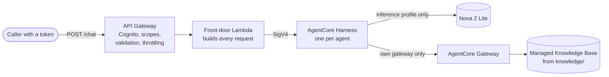

# agentharness

**A folder is an agent.** Describe an agent in three files, and agentharness deploys it to Amazon Bedrock AgentCore with AWS CDK, behind one secured front door. No agent code, no containers, no API keys.

```
agents/
└── helper/
    ├── agent.json     # model, limits, and who may call it
    ├── prompt.md      # system prompt
    └── knowledge/     # documents the agent can search (optional)
```

> **Status:** working MVP, deployed and verified in a real AWS account (London, eu-west-2). Not yet published to npm. The plan is in [docs/plan.md](docs/plan.md), and every design decision, with its reasons, is in [docs/decisions.md](docs/decisions.md).

## What it does



| You write                | You get                                                                                  |
| ------------------------ | ---------------------------------------------------------------------------------------- |
| `agents/<name>/`         | An AgentCore Harness (AWS runs the agent loop) with a least-privilege execution role     |
| `prompt.md`              | The system prompt                                                                        |
| `agent.json`             | Model, token, iteration and time limits, validated against a schema with readable errors |
| `knowledge/`             | An S3 bucket, a Managed Knowledge Base and a Gateway, used by a `Retrieve` tool          |
| `"callers": ["support"]` | A Cognito client for that team, allowed to call this agent and no other                  |

Two stacks per stage:

- **`agentharness-<stage>-auth`** is long-lived and termination-protected: the Cognito callers and the front door.
- **`agentharness-<stage>-agents`** is disposable: the agents and their knowledge. In the maintainer's account it is deleted every night.

The two stacks don't reference each other.

## What has been achieved

Everything below was deployed and checked live, not just synthesized:

| Area                       | Result                                                                                                                          |
| -------------------------- | ------------------------------------------------------------------------------------------------------------------------------- |
| Folder to agent            | `helper` answers from its `knowledge/` folder, with a visible `Retrieve` tool call and token counts                             |
| Knowledge sync             | `agentharness sync` mirrors `knowledge/` to S3, runs ingestion and fails naming any document that didn't ingest                 |
| Front door                 | No token → 401; extra fields such as `allowedTools` → 400; an agent the caller isn't granted → 403                              |
| Harness locked to IAM      | A token sent straight to a Harness → 403 ("use SigV4")                                                                          |
| Model pinned by IAM        | Asking for a different Bedrock model → `AccessDeniedException` from the execution role                                          |
| Why the front door matters | Before it existed, a token holder could override tools and got a root shell with internet access. That probe is recorded in D15 |
| Spend safety               | Nightly teardown, per-invocation token budget, short idle sessions, tagged resources for cost reports                           |
| Engineering hygiene        | Strict TypeScript, zero-warning typed lint, cdk-nag with every finding fixed or justified, unit and synth tests, leak scanning  |

## Principles

1. **Convention over configuration.** A user writes three files, and everything else (infrastructure, IAM, monitoring) is derived from them. Each file maps to an AWS resource you can point at. (D1)
2. **Configuration, not code.** The AgentCore Harness runs the agent loop, so there is no agent code to secure, patch or host. (D4)
3. **Enforce where something can actually say no.** Harness settings are defaults that a caller could override. So the real limits are IAM: the execution role, the front door's role and the permissions boundary. (D8, D15, D17)
4. **One front door.** Callers never touch an agent directly. One Lambda builds every request from `{ agent, message, sessionId }`, so overrides can't get through. (D17)
5. **Identity and money are long-lived; compute is disposable.** Credentials and the API survive; agents are torn down nightly and redeployed in minutes. (D15, D16)
6. **Least privilege, every exception justified.** Each IAM statement carries a `why`. Each wildcard is a documented cdk-nag acknowledgement, generated from that `why`. (`iam.ts`)
7. **No long-lived keys.** People sign in with `aws login`, CI will use OIDC, and callers use one-hour tokens. (D8, D11)
8. **Verified, not assumed.** Claims about AWS behaviour were checked against the docs and then probed live. Where they disagreed with our docs, the docs were corrected. (plan §13)
9. **Honest limits.** Budget alerts lag, and prompt injection is possible. The docs say so, and say what would change that. (plan §8, §11)
10. **Small and readable.** One concept per file, strict types with no `as` or `!`, schemas at every boundary, few comments, and conventional commits. (D12–D14)

## Security model

| Layer                          | Mechanism                                                                                                        | Enforced by               |
| ------------------------------ | ---------------------------------------------------------------------------------------------------------------- | ------------------------- |
| Who can deploy                 | Developer guardrails and a permissions boundary on every role; the `-auth` and bootstrap stacks can't be deleted | IAM                       |
| Who can call                   | A Cognito client per caller, a scope per agent, and the caller's current grants, checked again on every request  | API Gateway + front door  |
| What a call can do             | Only `{ agent, message, sessionId }` is accepted; the session is bound to the caller                             | Front door                |
| What an agent can reach in AWS | Its inference profile, its own gateway and its logs; `sts:AssumeRole` is denied                                  | IAM (execution role)      |
| What the front door can do     | Invoke this stage's Harnesses and read one stack's outputs; no commands or shells                                | IAM                       |
| How much it can spend          | Token, iteration and time limits per invocation; stage throttling; nightly teardown; budget alerts               | Harness, API Gateway, AWS |

**Known limits** (details in [decisions.md](docs/decisions.md) D17 and [plan.md](docs/plan.md) §8 and §11):

- A caller can still try prompt injection, and can read anything in the knowledge of an agent they're allowed to call.
- Throttling is per stage, not per caller.
- Per-agent automatic budgets are deferred, because AWS Budgets enforcement lags by hours.
- Inference uses Nova 2 Lite's global profile, so requests may be processed outside the UK.

## Develop

Requires Node 24 and pnpm (`corepack enable`).

```bash
pnpm install    # also installs the pre-commit hook
pnpm check      # format, build, typecheck, lint (zero warnings), test
```

Every commit runs the format check, typecheck, lint and gitleaks.

## Deploy and chat

Needs an AWS account set up as described in [docs/setup.md](docs/setup.md).

```bash
pnpm build
cd examples/helper
pnpm run deploy                      # both stacks, then sync the knowledge
pnpm chat helper                     # chat through the front door as `maintainers`
pnpm chat helper --caller demo       # ...or as another caller
pnpm destroy                         # removes the agents; access stays
```

`pnpm deploy` is a pnpm built-in, hence `pnpm run deploy`. The default stage is `dev`. For another stage, deploy with `pnpm exec cdk deploy --all -c stage=<name>`, then pass `--stage <name>` to `sync`, `chat` and `get-token`.

## Give a team access

1. Add the team to the agent, and merge the change through a reviewed PR:

   ```json
   { "model": "nova-2-lite", "callers": ["support"] }
   ```

2. Deploy. The `support` caller gets its own Cognito client, allowed to call this agent only.
3. Hand over a token, or the client ID and secret, through a secret store:

   ```bash
   pnpm get-token --caller support      # a one-hour access token
   ```

4. The team calls the front door. The URL is the `ApiUrl` output of the `-auth` stack.

   ```bash
   curl -N "${API_URL%/}/chat" -H "authorization: $TOKEN" -H 'content-type: application/json' \
     -d '{"agent":"helper","message":"When is the plant watered?","sessionId":"<a new UUID>"}'
   ```

   The answer streams back as one JSON object per line: `text`, `tool`, `usage`, `stopped` or `error`. Reuse the same `sessionId` to continue a conversation.

To revoke access, remove the caller from `agent.json` and deploy. The front door stops honouring it at once, even for tokens that haven't expired.

## Repo layout

| Path                     | What it is                                                                 |
| ------------------------ | -------------------------------------------------------------------------- |
| `packages/agentharness/` | The npm package: CDK constructs, the front-door Lambda and the CLI         |
| `examples/helper/`       | A complete example, laid out exactly like a user's own repo                |
| `ops/cleanup/`           | Separate app that deletes dev stacks every night (maintainer account only) |
| `docs/`                  | Decisions, plan, research, one-off AWS setup and IAM policy templates      |

Inside `packages/agentharness/src/`, one concept per file:

| File                                                        | Concept                                                                        |
| ----------------------------------------------------------- | ------------------------------------------------------------------------------ |
| `schema.ts`, `load.ts`                                      | The folder convention: `agent.json` schema, and folder → validated `AgentSpec` |
| `agent.ts`, `knowledge.ts`                                  | One Harness with its execution role; one knowledge base and gateway            |
| `auth.ts`, `api.ts`                                         | Cognito callers and scopes; the front door (API Gateway + Lambda)              |
| `request.ts`, `handler.ts`                                  | Front-door rules (pure, unit-tested) and the thin streaming Lambda             |
| `reply.ts`                                                  | The streamed reply format, shared by the Lambda and the CLI                    |
| `stack.ts`, `app.ts`                                        | The two stacks per stage, and the CDK app with cdk-nag                         |
| `iam.ts`, `names.ts`                                        | Roles with justified permissions; resource and output names                    |
| `cli.ts`, `chat.ts`, `token.ts`, `sync.ts`, `deployment.ts` | The `agentharness` command line                                                |
