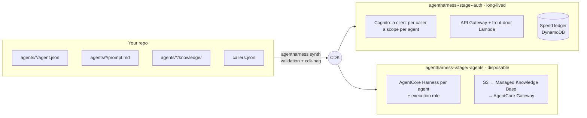
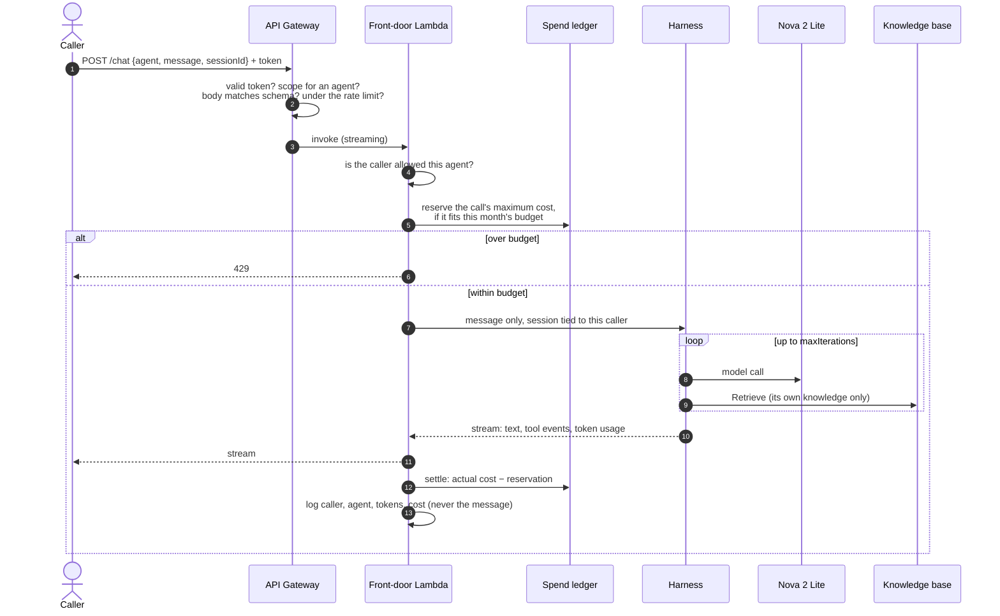

# agentharness

**A folder is an agent.** Describe an agent in three files, and agentharness deploys it to Amazon Bedrock AgentCore with AWS CDK, behind one secured, metered front door. No agent code, no containers, no API keys.

```
agents/
└── helper/
    ├── agent.json     # model, limits, and who may call it
    ├── prompt.md      # system prompt
    └── knowledge/     # documents the agent can search (optional)
```

- **No agent code.** AWS runs the agent loop (AgentCore Harness). You write a prompt and some settings.
- **Safe to share.** Other teams call your agents through one API with their own credentials. They can send a message, and nothing else.
- **Spend is capped.** Each caller has a monthly budget, enforced before every call.

> **Status:** early. It works end to end in AWS (London, eu-west-2), but isn't published to npm yet. Design decisions and their reasons are in [docs/decisions.md](docs/decisions.md); the plan is in [docs/plan.md](docs/plan.md).

## Quick start

Needs Node 24, the AWS CLI signed in to an AWS account, and a Region with AgentCore (tested in `eu-west-2`).

```bash
npx agentharness init my-agents
cd my-agents
npm install
npx cdk bootstrap      # once per AWS account and Region
npm run deploy         # deploy the agents and their API, then load the knowledge base
```

The starter's README shows how to get a token and call your agent, and how to make the agent your own. It's the same as [examples/helper/README.md](examples/helper/README.md).

> Until the first npm release, use the example in this repo instead: `pnpm install && pnpm build`, then `cd examples/helper && pnpm run deploy`.

## Define an agent

The folder name is the agent's name: 1–16 lowercase letters or digits, starting with a letter.

**`agent.json`**

```json
{ "model": "nova-2-lite", "maxTokens": 1024, "maxIterations": 5, "callers": ["support"] }
```

| Field            | Meaning                                                       | Default | Range          |
| ---------------- | ------------------------------------------------------------- | ------- | -------------- |
| `model`          | The model. Currently `nova-2-lite` (Amazon Nova 2 Lite)       | —       | required       |
| `maxTokens`      | Output tokens per call, across all of the agent's model calls | 1024    | 1–8192         |
| `maxIterations`  | Reasoning or tool steps per call                              | 5       | 1–20           |
| `timeoutSeconds` | Time limit per call                                           | 120     | 10–840         |
| `callers`        | Teams allowed to call this agent, besides `maintainers`       | `[]`    | names as above |

**`prompt.md`**: the system prompt, up to 20,000 characters.

**`knowledge/`**: any documents, up to 10 MB in total. If the folder exists, the agent gets a knowledge base and a `Retrieve` tool to search it. Run `pnpm sync` after changing it. The agent treats retrieved text as reference material, not instructions.

`agentharness synth` (run by CDK) validates every file and fails with a readable message before anything reaches AWS.

## Give a team access

1. List the team in `callers` in the agent's `agent.json`, as above.
2. Optionally set its budget in `callers.json`, beside `agents/`. The default is $5 a month per caller, `maintainers` included. `0` blocks a caller.

   ```json
   { "support": { "monthlyBudgetUsd": 20 } }
   ```

3. Deploy. The team gets its own Cognito client, allowed to call only the agents that list it.
4. Give the team its client ID and secret through a secret store. Both are on its app client in Cognito; the ID is also the `<caller>ClientId` output of the `-auth` stack. The team swaps them for a one-hour access token whenever it needs one, with Cognito's `GetClientToken` (any AWS SDK, or `aws cognito-idp get-client-token`). That call needs no AWS credentials.
5. The team calls the API. Its URL is the `ApiUrl` output of the `agentharness-<stage>-auth` stack.

   ```bash
   curl -N "${API_URL%/}/chat" -H "authorization: $TOKEN" -H 'content-type: application/json' \
     -d '{"agent":"helper","message":"When is the plant watered?","sessionId":"<a new UUID>"}'
   ```

The answer streams back as one JSON object per line: `text`, `tool`, `usage`, `stopped` or `error`. Reuse the `sessionId` to continue a conversation.

| Status | Meaning                                                |
| ------ | ------------------------------------------------------ |
| 401    | No valid token                                         |
| 400    | The body isn't exactly `{ agent, message, sessionId }` |
| 403    | The caller isn't allowed to call that agent            |
| 429    | The caller's monthly budget is used                    |
| 503    | The budget check is unavailable, so nothing was run    |

To revoke access, remove the team from `callers` and deploy. The change takes effect immediately, even for tokens that haven't expired.

## How it works

### Two stacks per stage



- **The `-auth` stack** holds who can call, the API, and what each caller has spent. It is long-lived and protected from deletion.
- **The `-agents` stack** holds the agents and their knowledge. It can be destroyed and redeployed at any time, for example nightly in development.
- The stacks don't reference each other: the front door finds each agent by name. Agents can be replaced without changing credentials, the API URL or spend records.

### One call



The front door is the only way in.

- **Harnesses accept only AWS-signed (IAM) requests**, and only the front door may sign them. A token sent straight to a Harness is refused.
- **The front door builds every request itself.** Callers can't change the model, prompt, tools or limits, and can't open a shell in an agent's session.

## Security model

AgentCore lets anyone who can call a Harness override its model, prompt and tools per request. Harness settings are therefore defaults, and the kit enforces its limits in IAM and in the front door instead.

| Layer                      | Mechanism                                                                                                 | Enforced by              |
| -------------------------- | --------------------------------------------------------------------------------------------------------- | ------------------------ |
| Who can deploy             | Developer guardrails and a permissions boundary on every role; long-lived stacks can't be deleted         | IAM                      |
| Who can call               | A Cognito client per caller, a scope per agent, and the caller's current grants, checked on every request | API Gateway, front door  |
| What a call can contain    | Only `{ agent, message, sessionId }`; sessions are tied to the caller                                     | Front door               |
| What an agent can reach    | Its own model profile, its own knowledge base and its logs; it can't switch roles                         | IAM                      |
| What the front door can do | Invoke this stage's agents and update the spend ledger; no shell or command access                        | IAM                      |
| How much can be spent      | Per call: token, step and time limits. Per caller: a monthly budget. Per account: an AWS Budget backstop  | Harness, front door, AWS |

**About budgets:**

- Budgets cover estimated **model** spend.
- Before each call, the front door reserves an estimate of the call's maximum cost, so concurrent calls can't overrun a budget together as long as each stays within its estimate. A call that costs more is still charged in full and logged (`overReservation`); calls in flight at the same time can each go over in this way.
- Other charges, such as runtime, knowledge base and logs, are kept small by session limits and teardown, and appear in Cost Explorer by tag.

**Known limits:**

- A caller can still attempt prompt injection.
- A caller can read anything in the knowledge of an agent they're allowed to call, so grant agents accordingly.
- Rate limiting is per stage, not per caller.
- Nova 2 Lite runs through a global inference profile, so requests may be processed outside the UK.

## Test an agent

For maintainers with access to the AWS account. Get a token for the `maintainers` caller, then chat in the terminal:

```bash
STACK=agentharness-dev-auth CALLER=maintainers
out() { aws cloudformation describe-stacks --stack-name $STACK --query "Stacks[0].Outputs[?OutputKey=='$1'].OutputValue" --output text; }
CLIENT_ID=$(out ${CALLER}ClientId)
SECRET=$(aws cognito-idp describe-user-pool-client --user-pool-id "$(out UserPoolId)" --client-id "$CLIENT_ID" \
  --query UserPoolClient.ClientSecret --output text)
export AGENTHARNESS_API_URL=$(out ApiUrl)
export AGENTHARNESS_TOKEN=$(aws cognito-idp get-client-token --client-id "$CLIENT_ID" --secret "$SECRET" \
  --query ClientAuthenticationResult.AccessToken --output text)

pnpm chat helper
```

`pnpm chat` runs [`tools/chat`](tools/chat), a small client that uses only the public API, the same way another team's app would. It isn't part of the published package.

To check a deployed stage end to end, run `pnpm smoke` (`STAGE=<name>` for a stage other than `dev`). [`tools/smoke`](tools/smoke) checks:

- the agent answers from its knowledge;
- the front door refuses missing tokens, extra fields and ungranted agents;
- a Harness refuses tokens and unapproved models;
- the spend ledger matches the cost of concurrent calls, and the budget limit returns 429;
- IAM simulations of both roles.

It needs AWS credentials and costs about a cent per run.

## Design principles

1. **Convention over configuration.** Three files per agent; infrastructure, IAM and monitoring are derived.
2. **Configuration, not code.** AWS runs the agent loop, so there's no agent code to secure or host.
3. **Enforce where something can say no.** Limits live in IAM and the front door, not in settings a caller could override.
4. **Cap spend before it happens.** Reserve before each call and settle after it, rather than finding out from the bill.
5. **Long-lived identity, disposable compute.** Credentials, the API and spend records outlive the agents.
6. **Least privilege, every exception explained.** Each IAM permission states why it exists, and each wildcard is justified to cdk-nag.
7. **No long-lived keys.** People use `aws login`, CI will use OIDC, and callers get one-hour tokens.
8. **Small and readable.** One concept per file, strict TypeScript, schemas at every boundary.

## Repository

| Path                     | What it is                                                         |
| ------------------------ | ------------------------------------------------------------------ |
| `packages/agentharness/` | The npm package: CDK constructs, the front-door Lambda and the CLI |
| `examples/helper/`       | A complete example, laid out exactly like a user's own repo        |
| `ops/cleanup/`           | Optional app that deletes dev agent stacks every night             |
| `tools/chat/`            | A terminal client of the API, for testing (not published)          |
| `tools/smoke/`           | Live checks against a deployed stage (not published)               |
| `docs/`                  | Decisions, plan, one-off AWS setup and IAM policy templates        |

Inside `packages/agentharness/src/`:

| File                                            | Concept                                                                  |
| ----------------------------------------------- | ------------------------------------------------------------------------ |
| `schema.ts`, `load.ts`                          | The conventions: file schemas, model prices, loading and validation      |
| `agent.ts`, `knowledge.ts`                      | One Harness and its execution role; one knowledge base and gateway       |
| `auth.ts`, `api.ts`                             | Cognito callers and scopes; the front door (API Gateway, Lambda, ledger) |
| `request.ts`, `serve.ts`, `handler.ts`          | Front-door rules and decisions (unit-tested); the Lambda's AWS wiring    |
| `spend.ts`, `ledger.ts`                         | Call cost and reservations (pure); the DynamoDB spend ledger             |
| `reply.ts`                                      | The streamed reply format, shared by the Lambda and the CLI              |
| `stack.ts`, `app.ts`                            | The two stacks per stage, and the CDK app with cdk-nag                   |
| `iam.ts`, `names.ts`                            | Roles with explained permissions; resource names                         |
| `cli.ts`, `init.ts`, `sync.ts`, `deployment.ts` | The `agentharness` command line: `init`, `synth` and `sync`              |
| `contract.ts`                                   | The API's request and reply formats, exported as `agentharness/contract` |

## Develop

```bash
pnpm install    # also installs the pre-commit hook
pnpm check      # format, build, typecheck, lint, test
```

Every commit runs the format check, typecheck, lint (zero warnings) and a secret scan.

## Licence

[Apache-2.0](LICENSE)
